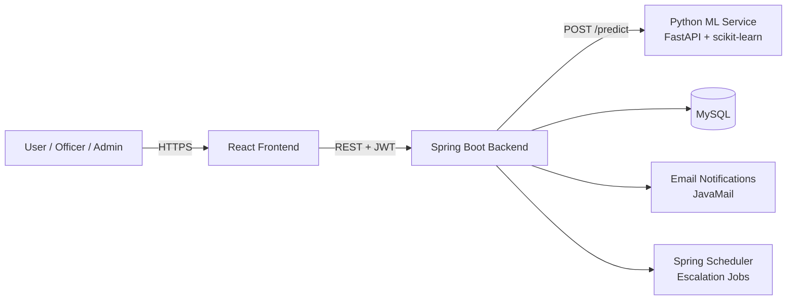

# AI-Powered Grievance Management and Resolution System

A full-stack web application that lets users submit grievances online and uses NLP to automatically **categorise** each complaint, **predict its priority**, and **route** it to the right department. Every grievance is tracked until it is resolved, and delayed cases are escalated automatically.

> 🚧 **Status: In active development.** Core features are being built; see the [Roadmap](#roadmap) for progress.

---

## The Problem

In many colleges, organisations and public offices, grievances are still collected through paper forms, emails or suggestion boxes. As a result:

- Complaints are classified by hand and often forwarded to the wrong department
- Grievances get lost or stay unresolved for weeks
- Complainants have no way to track progress
- Urgent issues (harassment, safety, ragging) get no priority over minor ones
- Authorities have no data on recurring problems

## The Solution

- 📝 **Online submission** with a unique tracking ID
- 🤖 **AI classification** into categories such as *Academic, Hostel, Infrastructure, Finance, Harassment*
- ⚡ **Priority prediction** (Low / Medium / High), with rule-based flags for critical complaints
- 🔀 **Automatic routing** to the concerned department or officer
- ⏱️ **Time-based escalation** of unresolved grievances
- 📧 **Email notifications** on every status change
- 📊 **Admin analytics** on category-wise, department-wise and resolution-time trends

---

## Architecture



**Grievance lifecycle:**

```
Submitted → Assigned → In Progress → Resolved → Closed
                ↘ (time limit exceeded) → Escalated
```

---

## Tech Stack

| Layer | Technologies |
|---|---|
| **Frontend** | React.js, HTML, CSS, Bootstrap |
| **Backend** | Java 17, Spring Boot 3.x, Spring Web, Spring Data JPA / Hibernate, Spring Security, JWT |
| **AI / ML** | Python 3.10+, scikit-learn (TF-IDF + Logistic Regression / Naive Bayes), pandas, FastAPI |
| **Database** | MySQL 8 |
| **Other** | JavaMail, Spring Scheduler, Maven, Postman, Git |

---

## Roles

| Role | Capabilities |
|---|---|
| **User** | Register, log in, submit grievances, track status, give feedback |
| **Officer** | View assigned grievances, update status, resolve |
| **Admin** | Manage departments and officers, reassign, view analytics dashboard |

---

## Project Structure

```
ai-grievance-management-system/
├── backend/        # Spring Boot REST API
├── ml-service/     # Python NLP classification service
├── frontend/       # React application
└── docs/           # Diagrams, schema, reports
```

---

## Roadmap

**Core**
- [ ] User registration and login (JWT, role-based access)
- [ ] Grievance submission with unique tracking ID
- [ ] Grievance status tracking
- [ ] Officer assignment and status updates

**AI module**
- [ ] Labelled grievance dataset
- [ ] Category classification model
- [ ] Priority prediction + urgency keyword rules
- [ ] ML prediction API (FastAPI)
- [ ] Accuracy evaluation report

**Automation**
- [ ] Automatic routing to departments
- [ ] Scheduled escalation of delayed grievances
- [ ] Email notifications on status change

**Dashboard and extras**
- [ ] Admin analytics dashboard
- [ ] File attachments
- [ ] Anonymous submission
- [ ] Feedback and rating after resolution
- [ ] Deployment

---

## Getting Started

> Setup instructions will be added as each module is completed.

### Prerequisites
- Java JDK 17+
- Maven
- Python 3.10+
- Node.js 18+
- MySQL 8

---