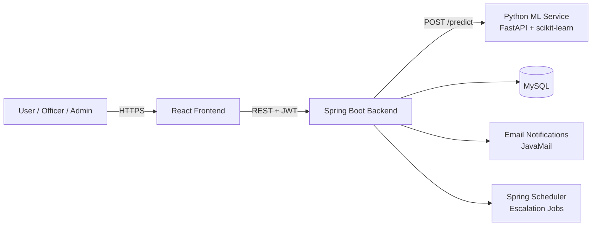

# AI-Powered Grievance Management and Resolution System

A full-stack web application that lets users submit grievances online and uses NLP to automatically **categorise** each complaint, **predict its priority**, and **route** it to the right department. Every grievance is tracked until it is resolved, and delayed cases are escalated automatically.

> 🚧 **Status: In active development.** Database entities are in place; the API, ML service and frontend are being built step by step. See the [Roadmap](#roadmap) for progress and [`plan.md`](plan.md) for the full specification (schema, API contract, build steps).

---

## The Problem

In many colleges, organisations and public offices, grievances are still collected through paper forms, emails or suggestion boxes. As a result:

- Complaints are classified by hand and often forwarded to the wrong department
- Grievances get lost or stay unresolved for weeks
- Complainants have no way to track progress
- Urgent issues (harassment, safety, ragging) get no priority over minor ones
- Authorities have no data on recurring problems

## The Solution

- 📝 **Online submission** with a unique tracking ID
- 🤖 **AI classification** into categories such as *Academic, Hostel, Infrastructure, Finance, Harassment*
- ⚡ **Priority prediction** (Low / Medium / High), with rule-based flags for critical complaints
- 🔀 **Automatic routing** to the concerned department or officer
- ⏱️ **Time-based escalation** of unresolved grievances
- 📧 **Email notifications** on every status change
- 📊 **Admin dashboard** with counts by category, status and priority, average resolution time and overdue cases

---

## Architecture



**Grievance lifecycle:**

```
Submitted → Assigned → In Progress → Resolved → Closed
                ↘ (time limit exceeded) → Escalated
```

Every status change is validated against a fixed transition table and written to an append-only audit trail.

---

## How It Works

1. A user logs in and submits a grievance (title + description) and receives a tracking ID such as `GRV-2026-483920`.
2. The backend sends the text to the ML service, which returns a **category**, a **priority** and confidence scores.
3. The grievance is routed to the department that owns that category and marked *Assigned*.
4. Officers of that department see it in their queue and move it through *In Progress* → *Resolved*; an admin closes it.
5. A scheduled job checks each department's SLA (72 hours by default). Anything still open past it is marked *Escalated* and the admin is notified.
6. The complainant gets an email on every status change and can check progress at any time with the tracking ID — no login needed.

### AI module

| Part | Approach |
|---|---|
| Features | TF-IDF over title + description (unigrams and bigrams) |
| Models | Two Logistic Regression classifiers: category (5 classes) and priority (3 levels) |
| Safety rules | Critical keywords (*ragging, harassment, threat, unsafe…*) force **High** priority regardless of the model |
| Evaluation | Train/test split grouped by source complaint so paraphrases never leak across the split; accuracy, per-class precision/recall and confusion matrices are reported |

### Design decisions

- **Submission never depends on the AI.** If the ML service is slow or down, the grievance is still saved as *Unclassified* and sent to the admin for manual routing.
- **Role-based access is enforced on the server** (JWT + Spring Security), not just hidden in the UI. Officers only see grievances of their own department.
- **Public tracking shows limited fields only** — status and timeline, never emails, descriptions or internal remarks.
- **Officer accounts are created by an admin**; public registration always creates a normal user.

### API overview

| Area | Endpoints |
|---|---|
| Auth | `POST /api/auth/register`, `POST /api/auth/login`, `GET /api/users/me` |
| Grievances | `POST /api/grievances`, `GET /api/grievances/my`, `GET /api/grievances/track/{trackingId}`, `GET /api/grievances/{id}` |
| Officer | `GET /api/grievances/assigned`, `PUT /api/grievances/{id}/status` |
| Admin | `GET /api/grievances`, `PUT /api/grievances/{id}/assign`, `GET /api/admin/stats`, `POST /api/admin/officers`, department management |
| ML service | `POST /predict` (internal, called by the backend only) |

Request and response shapes are in [`plan.md` §3](plan.md).

---

## Tech Stack

| Layer | Technologies |
|---|---|
| **Frontend** | React.js (Vite), HTML, CSS, Bootstrap |
| **Backend** | Java 17, Spring Boot 3.x, Spring Web, Spring Data JPA / Hibernate, Spring Security, JWT |
| **AI / ML** | Python 3.10+, scikit-learn (TF-IDF + Logistic Regression), pandas, FastAPI |
| **Database** | MySQL 8 |
| **Other** | JavaMail, Spring Scheduler, Maven, Postman, Git |

---

## Roles

| Role | Capabilities |
|---|---|
| **User** | Register, log in, submit grievances, track status (feedback after resolution is planned) |
| **Officer** | View their department's grievances, update status, resolve |
| **Admin** | Manage departments, create officer accounts, reassign grievances, close resolved cases, view analytics dashboard |

---

## Project Structure

```
ai-grievance-management-system/
├── backend/        # Spring Boot REST API
├── ml-service/     # Python NLP classification service
├── frontend/       # React application
├── docs/           # Schema, Postman collection, diagrams, reports
└── plan.md         # Full specification and step-by-step build guide
```

---

## Roadmap

**Core**
- [x] Database schema and JPA entities
- [ ] User registration and login (JWT, role-based access)
- [ ] Grievance submission with unique tracking ID
- [ ] Grievance status tracking
- [ ] Officer assignment and status updates

**AI module**
- [ ] Labelled grievance dataset
- [ ] Category classification model
- [ ] Priority prediction + urgency keyword rules
- [ ] ML prediction API (FastAPI)
- [ ] Accuracy evaluation report

**Automation**
- [ ] Automatic routing to departments
- [ ] Scheduled escalation of delayed grievances
- [ ] Email notifications on status change

**Dashboard and extras**
- [ ] Admin analytics dashboard
- [ ] Deployment

**Planned after the first release**
- [ ] Feedback and rating after resolution
- [ ] File attachments
- [ ] Anonymous submission
- [ ] Trend charts and exports

---

## Getting Started

> Setup instructions will be added as each module is completed.

### Prerequisites
- Java JDK 17+
- Maven
- Python 3.10+
- Node.js 18+
- MySQL 8

---