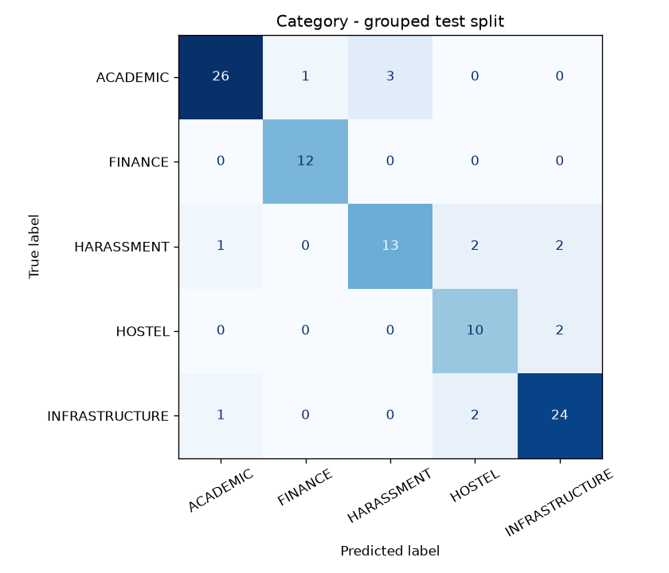
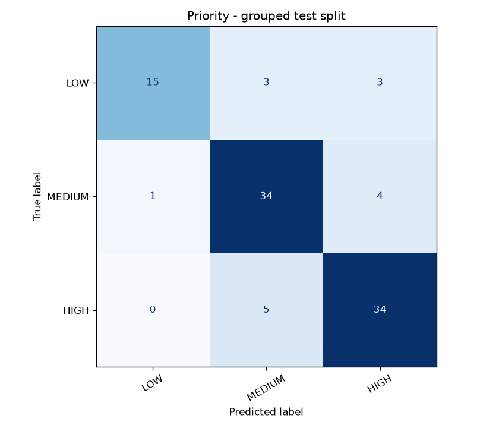

# ML evaluation

Every number here is copied from the output of `python train.py` followed by `python evaluate.py` (scikit-learn 1.9.1, Python 3.13.0). To reproduce, run those two commands; the split and the metrics are deterministic (`random_state=42`).

## Dataset

| | Rows | Groups |
|---|---|---|
| `data/grievances.csv` | 495 | 165 (three complaints on the same issue: rewordings or closely related cases) |
| Training side | 396 | 132 |
| Test side | 99 | 33 |
| `data/sanity.csv` (never trained on) | 50 | 50 |

Category balance: 99 rows in each of the five categories. Priority balance: LOW 132 (26.7%), MEDIUM 189 (38.2%), HIGH 174 (35.2%). The full category by priority table and the labelling rules are in `data/README.md`.

**Provenance.** The dataset was drafted with AI assistance. It is not hand-written by the student and not collected from real complaints. The student must read and correct it before submission and describe it this way in the report.

## How the split works, and why it is grouped

The three complaints of one group are about the same issue and share a `group_id`. `train.py` uses `GroupShuffleSplit` (80/20 by group, `random_state=42`), so a whole group lands on one side, and the script asserts that no `group_id` appears on both sides. A plain row-level split would put a rewording of a training complaint into the test set, and the model would be rewarded for recognising a complaint it has already seen.

A side effect of splitting whole groups at random is that the test side is not balanced: it holds 30 ACADEMIC, 27 INFRASTRUCTURE, 18 HARASSMENT, 12 HOSTEL and 12 FINANCE rows (priority: 21 LOW, 39 MEDIUM, 39 HIGH). With 12 rows in a class, one wrong prediction moves that class's recall by 8 points, so the per-class numbers below are rough.

Model: for each head, `TfidfVectorizer(ngram_range=(1, 2), max_features=5000, stop_words="english")` followed by `LogisticRegression(class_weight="balanced")`, fitted inside one pipeline so the vocabulary comes from the training rows only.

## Accuracy

| | Category | Priority, model alone | Priority, as served (model + `rules.py`) | MVP bar (test split) |
|---|---|---|---|---|
| Grouped test split (99 rows) | **0.8586** | **0.8384** | **0.8283** | category ≥ 0.75, priority ≥ 0.65 |
| Sanity set (50 rows) | **0.9200** | **0.8000** | **0.8000** | none; reported as is |

Both bars are met on the test split, by the model alone and as served.

"As served" is what `/predict` returns: the model's priority, then forced to `HIGH` if a critical keyword is present, then raised from `LOW` to `MEDIUM` if the predicted category is HARASSMENT. On the test split the rules changed 1 prediction (a true-LOW harassment query raised to MEDIUM, which counts as an error); on the sanity set they changed none, because every row with a keyword was already predicted HIGH.

**History of these numbers.** Each line is one retraining; the data was changed between them for reasons unrelated to the scores, and nothing was tuned against the sanity set.

| Version | Test category | Test priority (model) | Sanity category | Sanity priority (model) |
|---|---|---|---|---|
| 1. First dataset | 0.8788 | 0.8586 | 0.9000 | 0.8400 |
| 2. After first review: one HARASSMENT group relabelled to a written MEDIUM/HIGH boundary, about 60 descriptions rewritten for varied length and natural wording | 0.8687 | 0.8283 | 0.9000 | 0.8000 |
| 3. After second review (current): four training descriptions reworded (INF-019, HAR-022), one sanity label corrected | 0.8586 | 0.8384 | 0.9200 | 0.8000 |

**One sanity label was corrected after review.** SAN-HAR-10 (sarcastic remarks about a student's religious fasting and festivals) was labelled MEDIUM, but the written boundary in `data/README.md` puts conduct targeting religion in HIGH, and the matching training group is HIGH. It was relabelled HIGH to follow the rule. The model predicts MEDIUM for it, so the correction counts against the model. No other sanity row has ever been changed after scoring.

The headline sanity priority is still 0.8000 because the same retraining flipped one unrelated row, SAN-INF-08 ("Auditorium seats are broken", true MEDIUM), from LOW to the correct MEDIUM on a probability margin of about 0.003. With the label correction alone it would be 0.7800. The sanity category gain (0.9000 to 0.9200, one row, SAN-ACA-05) and both test-split changes (ACA-016 and FIN-019, one row each) are flips of the same size and should be read as noise, not as improvement or regression.

### What the priority numbers do not show

Most HIGH harassment rows contain a critical keyword, and the keyword rule decides those regardless of the model:

| | HARASSMENT/HIGH rows | of which contain a critical keyword |
|---|---|---|
| Training rows | 60 | 51 |
| Test split | 12 | 9 |
| Sanity set | 7 | 3 |

So the test split says little about how the model handles serious harassment that is described without one of those words: only 3 such rows are in it. The sanity set, with 4 of 7 keyword-free, is the fairer check, and it is still far too small to rely on.

## Per-class results: grouped test split

Category:

| Class | Precision | Recall | F1 | Support |
|---|---|---|---|---|
| ACADEMIC | 0.929 | 0.867 | 0.897 | 30 |
| FINANCE | 0.923 | 1.000 | 0.960 | 12 |
| HARASSMENT | 0.812 | 0.722 | 0.765 | 18 |
| HOSTEL | 0.714 | 0.833 | 0.769 | 12 |
| INFRASTRUCTURE | 0.857 | 0.889 | 0.873 | 27 |
| macro avg | 0.847 | 0.862 | 0.853 | 99 |
| weighted avg | 0.861 | 0.859 | 0.858 | 99 |

Priority (model alone):

| Class | Precision | Recall | F1 | Support |
|---|---|---|---|---|
| LOW | 0.938 | 0.714 | 0.811 | 21 |
| MEDIUM | 0.810 | 0.872 | 0.840 | 39 |
| HIGH | 0.829 | 0.872 | 0.850 | 39 |
| macro avg | 0.859 | 0.819 | 0.833 | 99 |
| weighted avg | 0.844 | 0.838 | 0.838 | 99 |

## Per-class results: sanity set

Category:

| Class | Precision | Recall | F1 | Support |
|---|---|---|---|---|
| ACADEMIC | 0.900 | 0.900 | 0.900 | 10 |
| FINANCE | 1.000 | 1.000 | 1.000 | 10 |
| HARASSMENT | 0.889 | 0.800 | 0.842 | 10 |
| HOSTEL | 0.833 | 1.000 | 0.909 | 10 |
| INFRASTRUCTURE | 1.000 | 0.900 | 0.947 | 10 |
| macro avg | 0.924 | 0.920 | 0.920 | 50 |
| weighted avg | 0.924 | 0.920 | 0.920 | 50 |

Priority (model alone):

| Class | Precision | Recall | F1 | Support |
|---|---|---|---|---|
| LOW | 1.000 | 0.538 | 0.700 | 13 |
| MEDIUM | 0.850 | 0.895 | 0.872 | 19 |
| HIGH | 0.696 | 0.889 | 0.780 | 18 |
| macro avg | 0.849 | 0.774 | 0.784 | 50 |
| weighted avg | 0.833 | 0.800 | 0.794 | 50 |

LOW recall on the sanity set is weak: 5 of 13 LOW rows were predicted HIGH.

## Confusion matrices (grouped test split)

Rows are the true class, columns the predicted class.

| true \ predicted | ACADEMIC | FINANCE | HARASSMENT | HOSTEL | INFRASTRUCTURE |
|---|---|---|---|---|---|
| ACADEMIC | 26 | 1 | 3 | 0 | 0 |
| FINANCE | 0 | 12 | 0 | 0 | 0 |
| HARASSMENT | 1 | 0 | 13 | 2 | 2 |
| HOSTEL | 0 | 0 | 0 | 10 | 2 |
| INFRASTRUCTURE | 1 | 0 | 0 | 2 | 24 |

Priority, model alone (this is what the image shows):

| true \ predicted | LOW | MEDIUM | HIGH |
|---|---|---|---|
| LOW | 15 | 3 | 3 |
| MEDIUM | 1 | 34 | 4 |
| HIGH | 0 | 5 | 34 |

Priority as served: LOW `14 4 3`, MEDIUM `1 34 4`, HIGH `0 5 34`.

Sanity set, category (same order): ACADEMIC `9 0 1 0 0`, FINANCE `0 10 0 0 0`, HARASSMENT `1 0 8 1 0`, HOSTEL `0 0 0 10 0`, INFRASTRUCTURE `0 0 0 1 9`. Sanity set, priority (model alone and as served are identical): LOW `7 1 5`, MEDIUM `0 17 2`, HIGH `0 2 16`.

## Low-confidence predictions and the backend's confidence floor

Text with no word the model knows (gibberish, Hindi in Devanagari, stop words only) produces an all-zero feature vector. The model then answers from its bias terms alone: HARASSMENT with confidence 0.2144, and "test" / "test" gives HARASSMENT 0.2387. Left alone, the backend would route such submissions to the Anti-Harassment Committee.

The backend therefore treats a category confidence below `app.ml.min-confidence` (env `ML_MIN_CONFIDENCE`, default 0.25) as no prediction: the grievance is saved as UNCLASSIFIED / MEDIUM / SUBMITTED and goes to the admin queue. A missing confidence is treated the same way. A prediction with `keyword_override=true` is kept whatever its confidence.

The floor also catches real complaints, because confidence is low across the board (median 0.3573 on the test split, 0.3662 on the sanity set):

| Floor | Test split: rows sent to manual triage | of those, classified correctly | Category accuracy on rows kept | Sanity set: rows to triage | of those, correct | Accuracy on rows kept |
|---|---|---|---|---|---|---|
| 0.25 (backend default) | 6 of 99 | 2 | 0.8925 | 1 of 50 | 0 | 0.9388 |
| 0.30 | 22 of 99 | 13 | 0.9351 | 11 of 50 | 10 | 0.9231 |

The default is 0.25: it catches the no-known-word cases (0.2144 and 0.2387) and sends about one grievance in twenty to manual triage. At 0.30 roughly one in five would go to triage, and most of those the model had right. The margin is thin: the lowest-confidence real complaint in the test split scores 0.2220, so no floor separates real complaints from unknown text cleanly. The value is a single environment variable.

## Misclassified examples

From the grouped test split unless marked.

1. **"Peeping into girls hostel bathroom"** (HAR-033): true HARASSMENT, predicted HOSTEL. "Hostel" is the strongest HOSTEL word in the model and "bathroom" also leans HOSTEL; "peeping" is not in the vocabulary because the whole group is on the test side. Place words pull harassment complaints towards the place's category; this is the main reason HARASSMENT has the lowest recall (0.722).
2. **"Project guide not available for meetings"** (ACA-016): true ACADEMIC, predicted HARASSMENT. This whole group is on the test side, so the only training rows in which a "guide" deals with a student are two HARASSMENT rows. The word carries a positive HARASSMENT weight and a negative ACADEMIC one.
3. **"Tube light and fan regulator faulty"** (HOS-017): true HOSTEL, predicted INFRASTRUCTURE. The text says "in my room" but never "hostel". Fans and lights are also what INFRASTRUCTURE rows about classrooms complain about, and without the word "hostel" the model cannot tell the two places apart.
4. **"Contaminated drinking water, students hospitalised"** (HOS-033): true HIGH, predicted MEDIUM (all three rows of the group). The token "water" is in 19 training rows, 18 MEDIUM and 1 HIGH (coolers, supply, leaks), so it is a strong MEDIUM signal; "sewage" is not in the training vocabulary at all. This is the most serious kind of error: a health risk that is under-prioritised and has no critical keyword to rescue it.
5. **"Can we get a workshop on LaTeX for report writing"** (sanity, SAN-ACA-01): true LOW, predicted HIGH. "Final", "project" and "report" lean towards HIGH in the model because the training rows that use them are about a submission deadline. The model keys on topic words, not on the absence of a deadline.

## Known limitations

- **Small, synthetic, single-style dataset.** 495 rows drafted with AI assistance share one style. Real complaints will be longer, messier, misspelt and often in Hinglish or Hindi; expect accuracy on real traffic to be lower than every number above. The sanity set comes from the same source, so it is a check against memorisation, not a measure of real-world accuracy.
- **Bag of words.** TF-IDF has no understanding of negation, severity or context. Place words ("hostel", "lab", "library") dominate, which misroutes harassment that happens in those places.
- **HIGH can be missed.** 5 of 39 HIGH test rows were predicted MEDIUM (and 2 of 18 in the sanity set). The keyword rule only covers the listed stems and phrases.
- **LOW is often over-prioritised.** On the sanity set 5 of 13 LOW rows came back HIGH.
- **Keyword rule matches from the start of a word.** `harass`, `threat`, `abus`, `urgen` and the other stems match any ending ("harassed", "threatens", "abusive", "urgently", "urgency"). It still misses misspellings ("harrasment"), Hindi or Hinglish words, and serious conduct described without any listed word ("he hit me", "he followed me home"). For those the priority falls back to the model.
- **Keyword rule ignores context, and it has known false positives.** Each of these is forced to HIGH: a procedural question that mentions the "anti-ragging committee"; "this is non-urgent" and "this is not an emergency"; "ragged clothes"; "the stalk of a plant"; "abuse of the wifi"; "killing time in the library". That is deliberate (a false HIGH costs an officer a minute), but expect it in a demo.
- **Unknown text is not recognised by the ML service itself.** It always returns one of the five categories. The protection is the backend's confidence floor described above, which at its default also sends about one in twenty ordinary complaints to manual triage.
- **A keyword hit on otherwise unknown text keeps a guessed category.** "help" / "urgent" is served as HARASSMENT 0.2499, HIGH, and the backend routes it to that department because a keyword hit bypasses the floor. The priority is right; the department may not be, and an admin has to reassign it.
- **HARASSMENT is never served as LOW.** A procedural query that the model files under HARASSMENT is returned as MEDIUM by design.
- **Confidence is not calibrated.** `category_confidence` is the largest `predict_proba` value. It is below 0.5 for most rows even when the answer is right; show it as a hint only.
- **Small test side.** 99 test rows (12 in two of the classes) and 50 sanity rows give wide error bars; a difference of a few points between runs of a changed dataset means little.
- **Five fixed categories.** A complaint that fits none of them (placement cell, medical centre, transport routes) is still forced into one.
